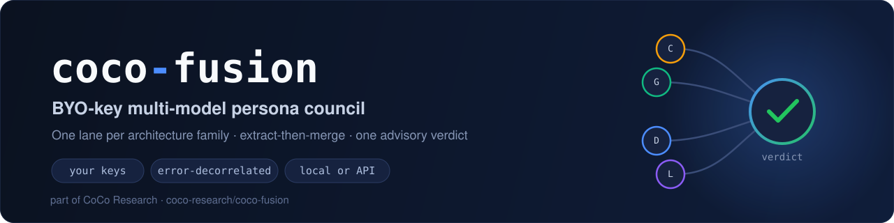
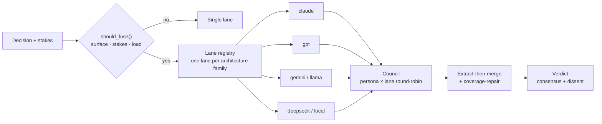

<p align="center">
  
</p>

<p align="center">
  
  
  
  
</p>

<p align="center">
  <b>Run a panel of expert personas across distinct model architectures, then synthesise a single advisory verdict.</b><br>
  <sub>Bring your own API keys · one lane per architecture family for error decorrelation · runs on API or fully local</sub>
</p>

<p align="center">
  <a href="#install">Install</a> ·
  <a href="#how-it-works">How it works</a> ·
  <a href="#quick-start">Quick start</a> ·
  <a href="#configure-lanes">Configure lanes</a> ·
  <a href="#architecture-families">Families</a>
</p>

---

## Why

Asking one model one question gives you one model's blind spots. **coco-fusion** convenes a council: it fans a decision out to expert **personas** running on **different model architectures**, then merges their positions into one verdict with explicit consensus and dissent. Picking one lane per architecture family **decorrelates errors** — Claude, GPT, Gemini, Llama, and DeepSeek don't fail the same way.

Bring your own keys. Lanes without a configured key are simply skipped, so it runs on whatever you have — including a fully local Ollama / LM Studio setup.

## How it works



- **Fusion policy** — deterministic `should_fuse()` gate by surface, stakes, and load
- **Lane registry** — OpenAI-compatible and Anthropic-direct lanes from env vars or config
- **Council orchestration** — persona × lane round-robin, extract-then-merge synthesis, coverage-repair
- **Providers** — OpenRouter, OpenAI, Anthropic, DeepSeek, Kimi/Moonshot, local Ollama/LM Studio

## Install

```bash
git clone https://github.com/coco-research/coco-fusion.git
cd coco-fusion
pip install -e .
```

## Quick start

```python
from coco_fusion import run_council

result = run_council(
    "Should we adopt event sourcing for the billing service?",
    stakes="high",
)
print(result.verdict)
print(result.consensus, result.dissent)
```

## Configure lanes

Set API key env vars for the lanes you want. **Lanes without a key are skipped.**

| Lane preset | Env vars |
|-------------|----------|
| Anthropic | `ANTHROPIC_API_KEY` |
| OpenAI | `OPENAI_API_KEY` |
| OpenRouter | `OPENROUTER_API_KEY` |
| DeepSeek | `DEEPSEEK_API_KEY` |
| Kimi (Moonshot) | `MOONSHOT_API_KEY` |
| Local (Ollama / LM Studio) | `LOCAL_LLM_BASE_URL` (e.g. `http://127.0.0.1:11434/v1`) |

Optional overrides: `OPENROUTER_BASE_URL`, `DEEPSEEK_BASE_URL`, `MOONSHOT_BASE_URL`, and model IDs via `COCO_FUSION_*_MODEL` env vars (see [`coco_fusion/lane_registry.py`](coco_fusion/lane_registry.py)).

### Custom lanes (config dict)

```python
from coco_fusion import Lane, build_lanes_from_config

lanes = build_lanes_from_config([
    {
        "lane_id": "my-gpt",
        "provider": "openai_compat",
        "base_url": "https://api.openai.com/v1",
        "api_key_env": "OPENAI_API_KEY",
        "model_id": "gpt-4o",
        "architecture_family": "gpt",
        "tier": "frontier",
        "rank": 0,
    },
])
```

## Architecture families

Fusion picks **one lane per architecture family** for error decorrelation:

`claude` · `gpt` · `gemini` · `llama` · `deepseek` · `local`

High stakes → frontier tier + high reasoning effort. Low stakes → budget tier.

## Personas

The bundled council in [`coco_fusion/personas.py`](coco_fusion/personas.py) is a small **generic** expert panel (architect, security, and peers) so the package runs standalone. The full, curated expert board is proprietary and lives in the main [CoCo](https://github.com/coco-research/coco) repo (`systems/superintelligence`); this package intentionally ships only the open shell. Register your own personas via the `Persona` dataclass in [`coco_fusion/council.py`](coco_fusion/council.py).

## License

**Proprietary — source-available.** Copyright © 2026 Coco Inc (coco-research). All rights reserved. The source is public for reference; running it locally with your own API keys is permitted, but use, copying, modification, and redistribution require a written agreement. See [LICENSE](LICENSE).

<sub>Part of <a href="https://github.com/coco-research/coco">CoCo Research</a> — open-core AI orchestration &amp; agentic developer tooling.</sub>
